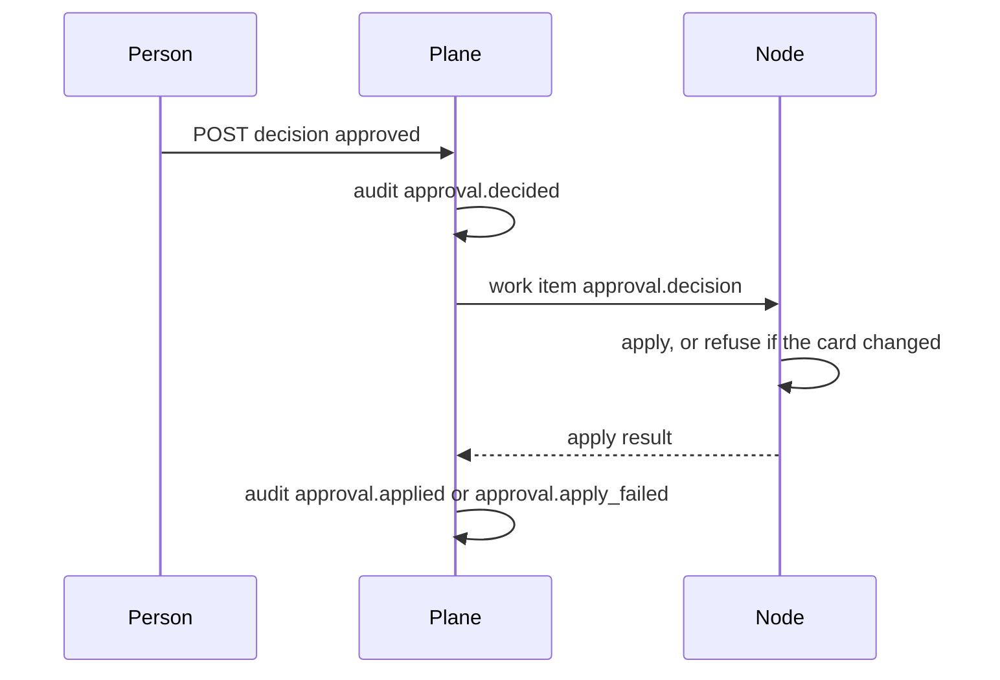

# Spec: approvals and the question queue

One queue for everything a bot must not do alone. The node enforces it. The plane lists it.

## What exists today

Cards are transcript messages. Questions use `QuestionRequestCardData` (`shared/ask-question.ts`). Today’s inbox reads unanswered cards from `messages.db` (`server/today.ts`). Host-computer use is a one-shot card (`use_your_computer`). Unattended routine runs do not get a free pass. The companion exposes a narrow set of approval verbs.

There is no org-wide queue. Agents Hub adds the index, not a second decision model.

## Kinds

`shell`, `edit`, `tool`, `question`, `message` (outbound WhatsApp, Slack, or email), `spend` (a connector call the workspace marked as spend).

## Record

On the node, the card stays in the transcript. On the plane, `ApprovalMeta`:

```text
id, workspaceId, nodeId, botId
kind, title, promptHash
state: pending | approved | denied | expired | cancelled
requestedAt, expiresAt
decidedBy?, decidedAt?
applyState: pending | applied | failed
```

`title` is a short label (“Send WhatsApp to a saved contact”, “Run a command on Hub”). The prompt body stays on the node. The plane stores `promptHash` so the audit can show that the decision matched the card.

Default TTL is the workspace’s `approvalTtlSeconds` (86400). Expiry is a deny for the side effect.

## API

| Method | Path | Does |
| --- | --- | --- |
| `GET` | `/api/v1/approvals?state=pending` | Metadata for workspaces the member can see |
| `POST` | `/api/v1/approvals/:id/decision` | `{ "decision": "approved" \| "denied", "answer": "..." }` |
| Node work item | `approval.decision` | The node checks the card is still pending and the hash matches, then applies |



A member may decide a card on a bot they can chat with. An admin may decide any card in the workspace. A guest may decide only cards on bots they are named on (P1).

Phone uses the same endpoint. There is no separate mobile decision API.

## Question cards

`kind: question` carries `answer` text, within the existing caps (6 questions, 12 options, 8000 characters). The node posts the answer into the transcript the way a typed reply does today.

## Unattended

A routine run that raises a card leaves the run `waiting`. It does not approve itself. If the card expires, the run is `failed` with reason `approval_expired`.

## Non-goals

- Editing the command in the queue and approving the edit as if it were the original. A change is a new card.
- Deleting audit rows when a card is denied.
