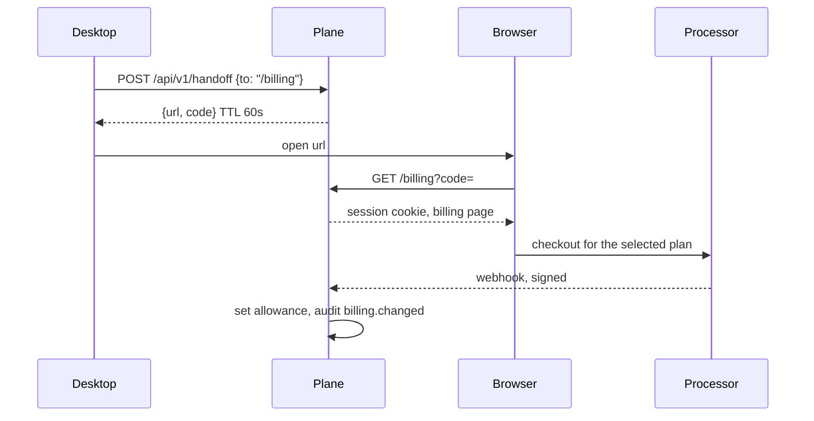

# Spec: billing

Self-host has no charge. A managed plan is sold on the website, not in the desktop window.

## What upstream does

`CloudProPopup` and `cloud-buy/` start a plan. The app never charges the card. Checkout is `https://checkout.dodopayments.com`, allow-listed in the account client. Prices arrive from the Admin in USD cents. The screenshot’s line is **Pro · $49/month + tax**. Upgrade of an existing Cloud is `upgradePreview` / `upgrade` on the cloud-plan bridge, with proration copy in `usageMeter.confirm.*` (“Today you pay {amount} with tax”). Team plan changes are “write to us” (`usageMeter.teamPlan`).

Agents Hub does not call Dodo and does not embed that popup.

## Packaging

From the PRD, still a proposal:

| Plan | Managed nodes included | Node-hours included | Attached nodes | Price placeholder |
| --- | --- | --- | --- | --- |
| Self-host | 0 | none | unlimited | $0 |
| Hosted plane | 0 | none | 3 | $20 / month |
| Pro | 1 | 360 | unlimited | $49 / month |
| Team | 3 | 1080 | unlimited | $99 / month |

Hours are per organization per month, shared across that plan’s managed nodes, shown per workspace as a breakdown. A workspace can still display its own plan chip when the org assigns one (the screenshot’s Pro / Team / Starter split). On self-host the chip says “Your machine.”

Tax is the processor’s job. The UI says “+ tax” only after the processor returns a tax amount. It does not invent a tax line.

## Where upgrade happens

The desktop What’s new carousel and the Settings row both use this handoff. They do not open a card form. `to` is a path on the plane, not an arbitrary URL.

Processor: Stripe is the proposal. Any processor the owner already uses is acceptable. Dodo is not, because it is upstream’s checkout host and the packaged build must not know it.

Webhook: signature verified, event id stored, replay ignored. The handler sets `Organization.mode = managed`, `includedSeconds`, `managedNodeQuota`, `periodEnd`. Failure to pay sets `past_due`, stops new managed nodes, does not delete disks for 14 days.

Cancel: self-serve on Billing. Access until `periodEnd`. Then managed nodes stop and the data export remains available for 14 days. Attached nodes are unaffected.

## Desktop surfaces that must not sell upstream

Removed or unmounted before a release, listed in [update-channel.md](update-channel.md): `CloudProPopup`, `CloudTrialIntro`, `ProIntroduction`, `cloud-buy/`, the notice id `cloud-pro-update-2026-10`.

## API

| Method | Path | Does |
| --- | --- | --- |
| `GET` | `/api/v1/billing` | Plan, period, allowance, invoices list (ids and totals, no card numbers) |
| `POST` | `/api/v1/billing/checkout` | Returns the processor URL for a plan id the plane knows |
| `POST` | `/api/v1/billing/portal` | Returns the processor’s customer portal |
| `POST` | `/api/v1/billing/webhook` | Processor only |

Self-host `GET /billing` returns `{ "mode": "self-host" }` and the page explains there is nothing to pay.

## Non-goals

- Per-seat pricing in MVP. Members are free on self-host. A managed Team plan includes a member cap in the proposal (10) only as a placeholder.
- Reselling Composio seats.
- Prorating inside the desktop. Proration text, if any, is the processor’s page.
