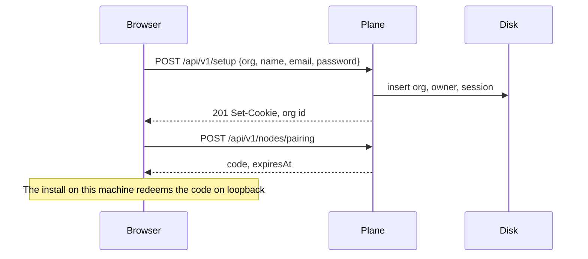

# Spec: control plane

The control plane is the website and API for an organization. It is new. The harness on each node stays the system of record for transcripts, bot files, and routine runs.

## Goals

- One Home for every workspace and node.
- Self-hostable as a process on the first node, or as its own service.
- Metadata only, by default.

## What exists today

There is no multi-node plane in this fork. The closest pieces:

- `cloudflare/control-plane/` — accounts, installations, tunnels. It does not store bots. Its default host is upstream’s.
- `electron/cloud-list.mjs` and `electron/cloud-home.mjs` — a client of upstream’s Admin API.
- `server/cloud-team.ts` — roles and a people file on one machine.

Agents Hub does not extend those upstream clients. It replaces the website they call.

## Deployment modes

| Mode | Process | Data | When |
| --- | --- | --- | --- |
| Embedded | Plane and node agent in one install on the hub | SQLite file `control-plane.db` next to the data dir, mode `0600` | All-local, and the default first-run |
| Split | Plane in its own container or VM | Postgres | Second node, or a team that wants the plane off the hub |
| Managed | Same split binary, hosted by the operator | Postgres per region | Paid plane |

Embedded and split speak the same API. A setting `plane.mode` is `embedded` or `remote`. Switching embedded to split is an export of `control-plane.db` and a restore onto Postgres, documented in [backups-migration.md](backups-migration.md). SQLite is the embedded store because the harness already uses `node:sqlite`. Postgres is the split store because more than one plane replica may exist later; MVP split is still a single plane instance.

## Data model

```text
Organization
  id, name, createdAt
  mode: "self-host" | "managed"
  planeVersion

Member
  id, orgId, email, name, role: "owner" | "admin" | "member" | "guest"
  passwordHash?            # self-host password; absent for invite-pending
  sessionVersion           # bump to revoke every session
  createdAt, disabledAt?

Session
  id, memberId, tokenHash, createdAt, expiresAt, userAgent, ipPrefix

Workspace
  id, orgId, name, color, kind: "general" | "personal"
  primaryNodeId?
  policy: "pinned"         # "standby" is v1, see scheduling-failover.md
  transcriptPolicy: "private" | "shared"
  approvalTtlSeconds       # default 86400
  createdAt, archivedAt?

Node
  id, orgId, name, kind: "local" | "docker" | "vm" | "managed"
  labels: string[]
  agentVersion, os, arch
  status: "pending" | "online" | "degraded" | "offline" | "revoked"
  lastHeartbeatAt, lastError?
  capacity: { cpu, memoryMb, diskMb, diskFreeMb }
  endpoint: { kind: "loopback" | "tailnet" | "lan" | "tunnel", host, port }
  credentialHash
  createdAt, revokedAt?

Placement
  workspaceId, nodeId, role: "primary" | "standby" | "draining"
  since, frozen: boolean

ApprovalMeta
  id, workspaceId, nodeId, botId, kind, title, promptHash
  state, requestedAt, expiresAt, decidedBy?, decidedAt?

AuditEvent
  id, orgId, at, actorId, action, targetType, targetId
  summary, metadata: object   # no secrets, no message bodies

CapacityRollup
  workspaceId, day, nodeSeconds, runCount

Invite
  id, orgId, workspaceId?, email, role, tokenHash, expiresAt, acceptedAt?
```

Bots, routines, and messages are not tables on the plane. The plane asks the primary node for lists it shows in the website, and caches those lists for 15 seconds so a flapping node does not blank the page. If the node is offline, the plane shows the last cache and a timestamp.

## API

Authentication: `Authorization: Bearer` for node agents, session cookie `ah_session` for the browser. Cookie is `Secure`, `HttpOnly`, `SameSite=Lax` when the origin is HTTPS. On loopback HTTP (embedded first-run) `Secure` is off and the listen address is loopback only.

| Method | Path | Who | Does |
| --- | --- | --- | --- |
| `POST` | `/api/v1/setup` | first run, no members yet | Creates org, owner, returns session |
| `POST` | `/api/v1/session` | public, if configured | Email + password, returns session |
| `DELETE` | `/api/v1/session` | member | Signs out |
| `GET` | `/api/v1/home` | member | Workspaces, node health, pending approval count, capacity this period |
| `GET` | `/api/v1/workspaces` | member | List |
| `POST` | `/api/v1/workspaces` | admin | Create. Body: `name`, `color`, `kind`, `primaryNodeId` |
| `GET` | `/api/v1/workspaces/:id` | member of it | Detail plus cached bots, routines, channels |
| `POST` | `/api/v1/workspaces/:id/move` | admin | Starts a move. See scheduling spec |
| `GET` | `/api/v1/nodes` | member | List |
| `POST` | `/api/v1/nodes/pairing` | admin | Mints a pairing code. See node spec |
| `GET` | `/api/v1/approvals?state=pending` | member | Queue metadata |
| `POST` | `/api/v1/approvals/:id/decision` | member who may decide | Forwards to the node |
| `GET` | `/api/v1/audit?before=&limit=` | admin | Newest first, limit max 200 |
| `GET` | `/api/v1/usage?workspaceId=&from=&to=` | member | Capacity and token summaries the node reported |

Errors: `{ "error": "code", "message": "one sentence" }` with 400, 401, 403, 404, 409, 429. 409 is for a move already running, or a node that is revoked.

## Home aggregation

`GET /api/v1/home` returns:

```json
{
  "org": { "id": "org_01", "name": "Northline", "mode": "self-host" },
  "member": { "id": "mem_01", "name": "Alex Rivera", "role": "owner" },
  "workspaces": [
    {
      "id": "ws_home",
      "name": "Home",
      "status": "running",
      "primaryNode": { "id": "nd_hub", "name": "Hub", "status": "online" },
      "bots": 8,
      "hoursUsed": 128,
      "hoursIncluded": null
    }
  ],
  "approvalsPending": 2,
  "nodesOnline": 2,
  "nodesTotal": 3
}
```

`hoursIncluded` is null on a self-hosted install. The UI shows used hours without a quota bar in that case, and shows used/included when a managed allowance exists.

## Sequence: first run



Setup is refused with 409 once any member exists.

## Security

- Password hashing: argon2id (memory 64 MiB, time 3, parallelism 1) or the platform’s current default if argon2 is unavailable in the runtime, recorded in the row as `passwordAlgo`.
- Session token: 32 random bytes, stored as SHA-256.
- `sessionVersion` on the member increments on password change and on disable. Sessions with an older version fail.
- Rate limit: 10 failed sign-ins per email per hour, then 429.
- Embedded plane listens on `127.0.0.1` until an admin sets a tailnet or LAN bind. Binding `0.0.0.0` requires an explicit setting `plane.listen` and refuses to start without a password on the owner.

## Non-goals

- Multi-region active-active plane.
- Storing `messages.db` on the plane.
- Compatibility with `cloud.openmausbot.com` session tokens.
