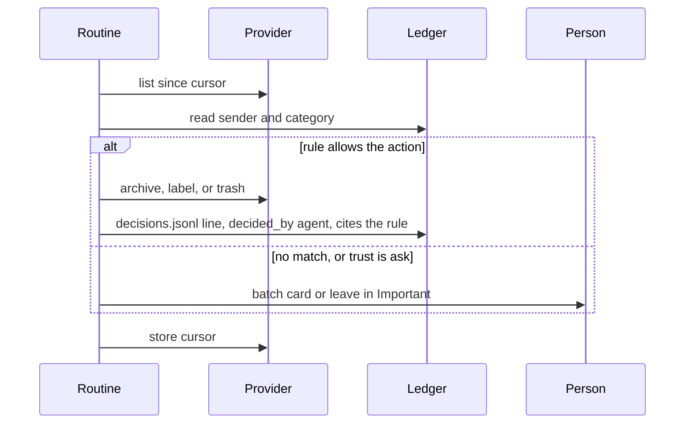

# Spec: inbox autopilot

The inbox agent runs the person’s mail the way a careful assistant would: split it, clean what the ledger already understands, and leave drafts and anything new for a person.

This is not a second mail host. Gmail and Outlook stay the mailboxes. Agents Hub is the triage surface and the actor.

## Goals

- Important is short. Other is handled.
- Cleanup of a known sender happens from the ledger, not from a fresh guess.
- A reply is a draft until a person sends it, unless that workspace has explicitly allowed earned send.
- The person can see why a message was archived.

## Providers

```text
InboxAccount
  id, workspaceId, nodeId
  provider: "gmail" | "outlook" | "imap"   # imap is P1
  address                                  # display only
  status
  cursor                                   # provider history id, on the node
```

Gmail (P0) uses the connector interface, Composio or a Gmail OAuth the person completes on their own project. Outlook (P1) uses the same interface through Pipedream or Nango (Microsoft Graph). The inbox agent calls:

| Call | Does |
| --- | --- |
| `list` since cursor | New and changed messages, metadata plus body when a card needs it |
| `get` | One message |
| `archive` / `trash` / `label` / `move` | The action, only after the policy below allows it |
| `draft` | Create or update a draft, never send |
| `send` | Send an existing draft, only with an approval id |
| `snooze` | Provider snooze if it has one, otherwise Agents Hub hides and restores |

Tokens stay with the connector. The ledger stores the address and the decisions, not the refresh token.

## Split inbox

Every new message is classified into **Important** or **Other**.

| Bucket | Rule |
| --- | --- |
| Important | Sender or category rule says `keep`, or there is no rule and the sender looks like a person (a display name, a reply to the person’s own mail, or not a bulk header) |
| Other | A rule says `archive`, `trash`, or `label` into a non-person category, or the message is a list / notification and no rule says `keep` |

Unknown bulk mail stays in Other as **unresolved**. It is not archived until a rule exists. Unknown person mail stays in Important. The agent asks about unresolved Other in a batch, not one card per message, once a day or when the person opens the inbox.

The Inbox page is the split. It is not a third copy of the mailbox: acting on a row calls the provider.

## What the agent may do alone

| Action | Alone, before trust | After trust |
| --- | --- | --- |
| Summarize | yes | yes |
| Leave a reply draft | yes | yes |
| Label | no, unless a label rule matches | yes, when `label` trust matches |
| Archive | no | yes, when `archive` trust matches |
| Trash | no | yes, when `trash` trust matches |
| Send, or send a follow-up | no | only if `policy.outgoing_trust` is `explicit` and this sender has an `approve` of `send` repeated to the threshold, still per sender |

Default `outgoing_trust` is `off`. Editing drafts does not count toward send trust. Archive decisions do not count toward send trust. The workspace Settings switch is the only way to turn earned send on, and the Ledger page must show the sender’s send rule before the first automatic send.

Trust thresholds live in `policy.yaml` ([learning-ledger.md](learning-ledger.md)). They count consistent human decisions with no later `reject`. Three archives earn archive. Five trashes, and archive trust already held, earn trash. Two labels earn label. A single `reject` resets that sender to `ask`.

Until trust is earned, the agent batches:

- “Archive 14 from news@example.com. This would start a rule.”
- “Trash 6 receipts from payments@store.example. Trash stays ask until you confirm a rule.”

Approving the batch writes one decision per sender or category, not one per message, unless the person expands the batch and picks rows. Applying the batch to the messages is allowed because they approved that action. The next identical message follows the new rule.

## Summaries

A routine `inbox.morning` on the primary node, default 07:30 in the workspace timezone:

- Posts into the main agent’s chat: counts, the Important list (sender, subject, one line), and Other as “42 archived from rules, 6 waiting for you.”
- Does not include full bodies in the chat line. The Inbox page has the bodies, fetched on open.

Each Important thread shows a one-line summary on the row. The summary is computed on the node and cached next to the cursor. It is not written to the ledger.

## Drafts

On an Important thread that asks for a reply, or when the person hits Reply, the inbox agent writes a draft in the provider and a card in the queue. The card shows the draft. Actions: Approve and send, Edit, Reject.

Edit writes `edit_draft` and updates the provider draft. The main agent compiles a style note only from the `reason` and the structural hint, so the next draft to that sender starts closer. Approve and send writes `approve` with `object.action = send` and then calls `send` with that approval id. Reject writes `reject` and deletes the draft.

## Snooze, reminders, follow-up

`inbox/state.yaml` on the node, beside the ledger but **not** a rule file. One-off snoozes live here. They are not decisions unless the person checks “always.”

| Feature | Behavior |
| --- | --- |
| Snooze | Hide until a time, then return to Important. Provider snooze when the provider has it. |
| Reminder | “Bring this back if I don’t reply by Friday.” A routine checks it. |
| Follow-up nudge | A sent message with no reply in the workspace’s follow-up window (default 3 days) becomes a card: “Nudge Ada?” Sending the nudge is a send. |

## Auto labels

When a label rule matches, the agent applies the label at triage time and does not ask. The row shows the label. Correcting it writes `label` or `reject` and recompiles.

## Triage loop



The cursor moves only after the batch is either acted or queued. A crash retries the same page. Provider ids make the apply idempotent.

## Pages

The product’s Inbox page: Important, Other, Drafts, Snoozed, Waiting for approval. The Ledger page is separate and shows why.

## Plane

The plane lists accounts (address, provider, status) and counts (important, unresolved, drafts). Bodies and the ledger stay on the node.

## Non-goals

- Sending on first sight of a sender.
- Marketing campaigns or mail merge.
- A shared inbox for a team in MVP. A workspace inbox is the connected mailbox of one member, visible to people the workspace role allows. Team shared mailboxes are P1 and use the same ledger.
- Learning from messages in a workspace the person cannot see.
