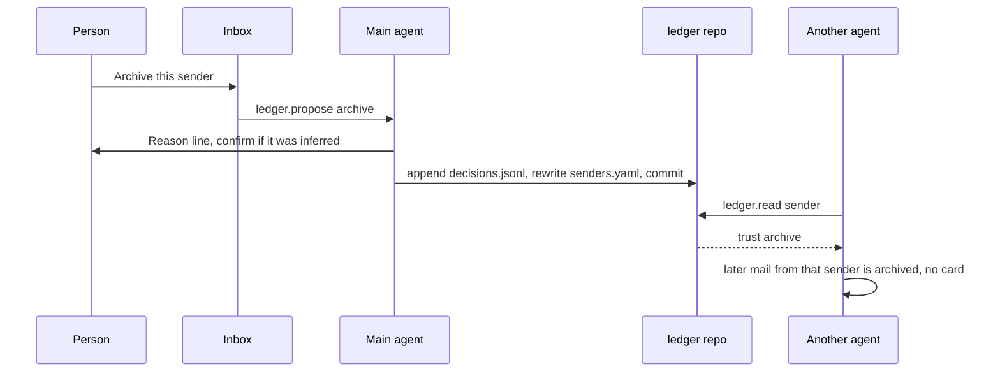

# Spec: learning ledger

The main agent learns from the person. The memory is a private git repository on the workspace’s node, not a prompt and not a row on the control plane.

## Goals

- Every decision the person makes is durable, diffable, and revertible.
- Every agent in the workspace reads the same rules.
- Agents ask only when the ledger does not already cover the case.
- The person can open the files and see why a rule exists.

## What exists today

Bots have `soul` and an optional memory flag. `SOUL.md` in the bot folder mirrors the persona. Nothing records “the person archived this sender” as data other agents must obey. Approvals are transcript cards. They are not compiled into rules.

The ledger does not replace `soul`. Persona stays prose. Policy becomes files.

## Where it lives

```text
<AH_DATA_DIR>/workspaces/<workspaceId>/ledger/     # a git repo, mode 0700
  README.md
  decisions.jsonl
  email/senders.yaml
  email/categories.yaml
  email/labels.yaml
  policy.yaml
```

- Created on the first decision, with `git init` and a root commit that adds `README.md` and an empty `decisions.jsonl`.
- No remote. An admin may add one later. The product never pushes.
- The main agent’s git identity is `Agents Hub <ledger@localhost>`. Commits are local.
- The repo is not inside the person’s project folder. A bot’s shell does not get it as a working tree it can edit. Agents read through a ledger tool that serves the files. Only the main agent’s commit path can write.
- Backups include the ledger inside the workspace backup. The plane does not get a plaintext copy. A backup is ciphertext, as in the backup spec.
- A move of the workspace moves the repo with the data dir. It is not sticky the way a WhatsApp session is.

## Who writes

Each workspace has one bot with `role: "main"`. That bot is the only writer. Other bots, routines, and the inbox agent call `ledger.propose`. The main agent turns a proposal into a commit only when the person made the decision, or when a rule says the main agent may compile an already-recorded decision. A proposal is not itself a decision.

If the main agent is paused, proposals queue on the node and the Ledger page shows them as uncommitted. No other agent commits “to be helpful.”

## The log

`decisions.jsonl` is append-only. One JSON object per line. Agents do not rewrite a line. A correction is a new line.

```json
{
  "id": "dec_01HZX",
  "date": "2026-11-01T15:04:00Z",
  "action": "archive",
  "reason": "Newsletter. I never open these.",
  "decided_by": "mem_alex",
  "workspace_id": "ws_home",
  "surface": "email",
  "object": {
    "provider": "gmail",
    "id": "msg_18c",
    "sender": "news@example.com",
    "category": "newsletter"
  },
  "source": "user",
  "compiled_to": "email/senders.yaml#news@example.com"
}
```

Required fields, always: `action`, `reason`, `decided_by`, `date` (the `date` key; ISO-8601 UTC). `decided_by` is a member id, or `agent:<botId>` only when a trusted rule applied an action with no new human click. Those agent lines cite the rule and the human decisions that earned it. They are not a substitute for a human decision.

`action` is one of:

| Action | When it is written |
| --- | --- |
| `keep` | The person marks a thread important, or moves it to Important |
| `archive` | The person archives, or approves an archive batch |
| `trash` | The person trashes, or approves a trash batch |
| `label` | The person applies or corrects a label |
| `approve` | The person approves a card (send, shell, or a proposed cleanup) |
| `reject` | The person denies a card or undoes an agent action |
| `edit_draft` | The person changes a draft before sending or discarding it |
| `snooze` | The person snoozes and chooses “remember this” |
| `remind` | The person sets a follow-up rule, not a one-off nudge |

`reason` is the person’s words when they typed any, otherwise a single sentence the main agent shows them before the commit (“Archive mail from news@example.com”). They can edit that sentence. It is stored. The message body is not.

`edit_draft` stores a short structural note, not the draft: `{ "changed": ["greeting", "ask"], "shorter": true }`. The full before/after stays in the provider’s draft. If the person wants the style rule in prose, that sentence is the `reason`.

## Compiled rules

`email/senders.yaml` is what agents read first. The log is the evidence. The YAML is the policy.

```yaml
version: 1
senders:
  news@example.com:
    action: archive
    trust: archive
    category: newsletter
    reason: Newsletter. I never open these.
    decided_by: mem_alex
    decisions: [dec_01HZX, dec_01HZY]
    updated: 2026-11-01T15:04:00Z
```

`email/categories.yaml` holds the same shape keyed by category (`newsletter`, `receipt`, `person`, `calendar`, `other`). A sender rule beats a category rule. A newer decision beats an older one.

`email/labels.yaml` maps sender or category to a label string.

`policy.yaml` holds workspace thresholds. Defaults:

```yaml
version: 1
archive_trust_after: 3          # consistent archive decisions, no reject since
trash_trust_after: 5            # and archive trust already held
label_trust_after: 2
outgoing_trust: off             # never inferred; admin must set "explicit"
contradiction_resets: true
```

Trust values on a sender: `ask`, `label`, `archive`, `trash`. `send` is not a trust value in the default policy. See [inbox-autopilot.md](inbox-autopilot.md).

Compiling is deterministic. Given the log and `policy.yaml`, the YAML files are a pure function. The main agent recomputes them on each commit and the git diff is the change. A bug in compiling can be fixed by recomputing. The log is not regenerated.

## How agents read

Tool `ledger.read`, available to every bot in the workspace:

- Input: `{ surface, sender?, category? }`
- Output: the matching sender rule, else the category rule, else `{ "match": false }`

The tool reads the files. It does not call the model. A turn that can act on mail, a card, or a draft calls `ledger.read` before the action. The harness rejects a destructive tool call whose target matches a rule of `ask`, and rejects one that matches nothing, unless the call is itself “create an approval card.”

Match order:

1. Sender rule.
2. Category rule.
3. No match. Ask. Do not act.

A `reject` decision for a sender sets trust back to `ask` and records the contradiction. The old rule remains in git history.

## Commits

One decision, one commit. Message format:

```text
archive news@example.com

dec_01HZX decided_by mem_alex
```

No message body, no subject, no secrets in the commit message. `git log` is the version history the Ledger page shows.

Revert: an admin chooses a commit on the Ledger page. The main agent adds a new decision `reject` that points at the reverted decision id, recompiles, and commits. `git revert` is allowed only as the implementation of that, and only if the result still matches a recompile. History is not destroyed.

## Plane

`GET /api/v1/workspaces/:id/ledger` returns a summary the node caches: last commit time, decision count, counts by action, and the compiled sender table **without** message ids. The browser then loads file text from the node through the same handoff as chat, so the plane’s database does not keep the YAML. A member who cannot see the workspace cannot see the ledger. A guest cannot.

## Sequence



## Privacy

- The ledger will contain email addresses and short reasons. That is sensitive. Mode `0700`, excluded from logs, excluded from analytics, excluded from the plane’s database.
- Support bundles do not include it.
- Deleting a workspace deletes the repo after the typed confirmation, unless the person exports first.

## Non-goals

- A vector database of past mail.
- One ledger shared across workspaces. Family and Home do not share rules.
- Agents editing YAML by hand in a shell. They go through the commit path.
- Learning from mail the person has not touched. Reading a message is not a decision.
