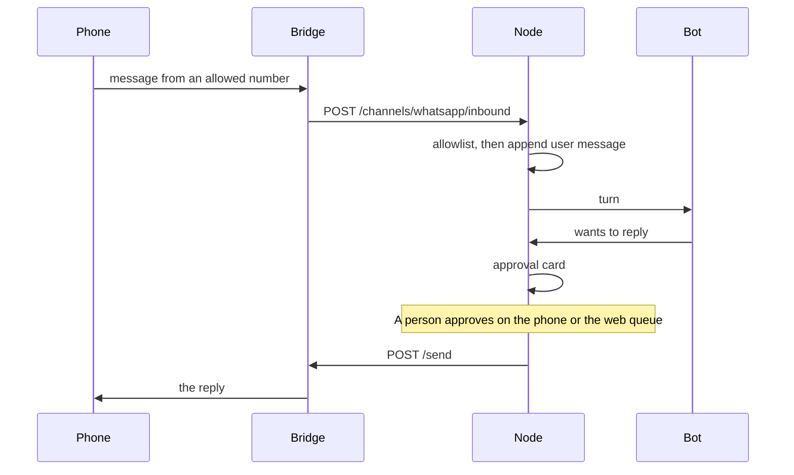

# Spec: messaging channels

WhatsApp must keep working. Slack and email are the other two MVP channels. All three are adapters on a node, not features of the control plane.

## Model

```text
Channel
  id, workspaceId, nodeId
  kind: "whatsapp-bridge" | "whatsapp-phone" | "slack" | "email"
  sticky: boolean
  status: "setup" | "online" | "offline" | "error"
  allowlist: string[]          # phone numbers, slack user ids, or emails
  route: { botId } | { groupId }
  display: { label }           # "WhatsApp · hub", no secrets
```

The secret (bridge token, Slack signing secret, mailbox token) lives in the node’s secret file, mode `0600`. The plane stores the display and the status line.

`sticky: true` for `whatsapp-bridge`. A move does not copy the session. See [scheduling-failover.md](scheduling-failover.md).

## WhatsApp bridge

The owner already runs a bridge daemon. MVP does not replace it. The adapter is an HTTP client on the node:

| Node calls | Purpose |
| --- | --- |
| `GET {base}/health` | Status for the channel page |
| `POST {base}/send` `{ to, text, approvalId }` | Only after an approval is `approved` |
| Bridge calls the node | `POST /channels/whatsapp/inbound` `{ from, text, id }` with the shared secret |

`base` and the secret are configured on the node (a URL on localhost or on the tailnet). They are not typed into the plane’s database.

Inbound: if `from` is not on the allowlist, the node drops it and writes an audit row `channel.dropped` with the hash of the number, not the text. If it is allowed, the text becomes a user message on the route’s bot or room, the same way a typed chat does.

Outbound: the bot’s `PHONE_SEND_WHATSAPP`-shaped intent, or a bridge send the bot requests, becomes an approval card unless the workspace policy for that allowlist is `auto`. Default is ask. There is no bulk endpoint and no “message everyone” tool.

This is the operator’s daemon. Agents Hub does not ship a Baileys client in MVP, does not store WhatsApp sessions on the plane, and does not automate outbound to people who have not written first. A later official WhatsApp Business Cloud API adapter is the supported path for a business number. Hermes’s public guide is the reference for that split, not code to copy.

## WhatsApp phone sheet

`server/phones/tools.ts` `PHONE_SEND_WHATSAPP` stays: the paired phone shows a sheet and the person taps Send. It is `whatsapp-phone`, `sticky: false`, and it works when no bridge is configured. Both can be on. They are different channels.

## Slack

MVP accepts either:

- a Slack app on the node (bot token and signing secret), events posted to the node’s webhook URL, or
- a Composio Slack trigger, which arrives through the connector spec.

One is enough to ship. The `Channel` row looks the same. Hosted Slack management that depends on `enterprise/` is not used.

## Email

MVP is a connector trigger (new Gmail) routed like a Slack event. IMAP is P1. There is no HighLevel email send.

## Plane API

`GET /api/v1/workspaces/:id/channels` returns the model above, from the node cache. Create and delete are work items to the node (`channel.upsert`, `channel.delete`). The plane never sees the secret field; the upsert body the browser sends is forwarded once and not logged.

## Sequence: inbound WhatsApp



## Non-goals

- A second WhatsApp session on the control plane “for failover.”
- Sending on the person’s personal number by default. The setup copy recommends a dedicated number.
