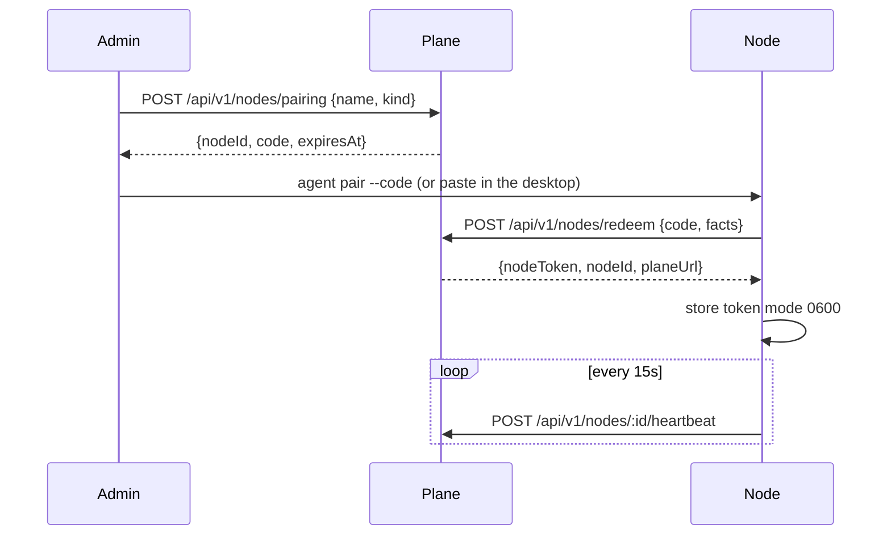

# Spec: node agent and pairing

A node is any machine that runs Agents Hub’s agent and the harness, paired to one organization.

## Goals

- The same agent on a Mac, a Linux box, a Docker host, a VM, and a managed machine.
- Pairing a person can do from the website without opening a port to the internet.
- A revoked node cannot keep acting.

## What exists today

- The harness is `server/openmausbot.ts`, data dir `~/.openmausbot`.
- The desktop spawns it from `electron/main.mjs`.
- `connector/` enrolls a Docker host with a code on stdin, heartbeats, and runs jobs for bot boxes. Identity is `ConnectorIdentity` (`version`, `protocol`, `image`). Health includes disk and Docker info.
- Phone pairing (`shared/pairing-link.ts`) is a one-time token for a **person’s device**, not for a server. Keep that for phones. Node pairing is a different credential.

## Install shapes

| Shape | How it is installed | Plane |
| --- | --- | --- |
| Desktop | The Electron app gains a “This computer is a node” switch. Default on for the first machine. | Embedded on that machine unless `plane.url` is set |
| Docker | `docker compose` from the docs: `plane` (optional), `node`, a volume for the data dir. | Embedded in the same compose, or `PLANE_URL` |
| Linux package | A systemd user or system unit, data dir `/var/lib/agents-hub` or `~/.agents-hub` | Remote, or embedded |
| Mac hub | The desktop app, or a launchd agent for a machine with no display | Same |
| Managed | The plane calls a provisioner (P1). The image is the Docker shape | Remote, credential injected at first boot |

The Docker shape is the reference for “a server.” The desktop shape is the reference for “a Mac on the desk.” They share the agent code.

Environment:

| Variable | Meaning |
| --- | --- |
| `AH_DATA_DIR` | Replaces `OMB_DATA_DIR` for new installs. If unset, and `~/.openmausbot` exists, and `~/.agents-hub` does not, the node offers to adopt the old dir (see backups spec). |
| `AH_PLANE_URL` | Empty means embedded. Otherwise the plane origin. |
| `AH_NODE_TOKEN` | Set after pairing. File mode `0600` if passed via file `AH_NODE_TOKEN_FILE` instead, which is the preferred path. |
| `AH_LISTEN` | Default `127.0.0.1:8799` for the harness. The agent API binds the same host, port `8800`. |

## Pairing

Admin creates a code. The node redeems it. The plane stores only a hash of the node token.



`POST /api/v1/nodes/redeem` body:

```json
{
  "code": "AH-7QFK-2M9C",
  "facts": {
    "os": "darwin",
    "arch": "arm64",
    "agentVersion": "0.1.0",
    "labels": ["desktop", "tailnet"],
    "capacity": { "cpu": 8, "memoryMb": 16384, "diskMb": 480000, "diskFreeMb": 210000 }
  }
}
```

Code alphabet is uppercase unambiguous (no 0/O, 1/I). 10 characters in two groups, at least 50 bits, plus server-side rate limit. TTL 10 minutes. Single use. Redeem from an unknown source is fine; the code is the secret.

Response `nodeToken` is shown once. It is 32 random bytes, base64url. Plane stores SHA-256.

Heartbeat body: `agentVersion`, `capacity`, `labels`, `workspaces` (ids placed here and whether routines are frozen), `lastError` (one line, 200 chars, redacted), `load`.

Status rules, evaluated by the plane when a heartbeat arrives and on a timer every 15 seconds:

| Condition | Status |
| --- | --- |
| Heartbeat age under 30s | `online` |
| Age 30s to 90s | `degraded` |
| Age over 90s | `offline` |
| Credential revoked | `revoked` (heartbeats 401) |

`POST /api/v1/nodes/:id/revoke` (admin) deletes the credential hash, sets `revoked`, and tells the node on its next heartbeat. The node then refuses local admin actions until paired again. Workspace data on disk is not deleted by revoke.

## How the node reaches the plane, and the reverse

MVP assumes the **node dials the plane**. The plane does not need to dial the node for heartbeats, approvals forwarding, or list caches:

- The node long-polls `GET /agent-wait` on the plane (25 seconds) for work items: approval decisions, placement changes, list requests.
- This matches the Composio broker’s long-poll (`GET /v1/events`) and works behind NAT, which a homelab needs.
- Tailscale is optional and recommended when a person also wants to open the harness UI directly. It is not required for pairing.

Work item shape:

```json
{ "id": "wi_01", "type": "approval.decision", "workspaceId": "ws_home", "body": {} }
```

The node acks with the result. Unacked items retry for 24 hours, then the plane marks them failed and writes an audit row.

## Labels

Free-form strings the node reports, plus reserved ones the agent sets itself:

| Label | Set when |
| --- | --- |
| `whatsapp` | A WhatsApp bridge adapter is configured on this node |
| `desktop` | A GUI session exists (Mac app, or Linux with the Cua path) |
| `docker` | Docker socket is usable for bot computers |
| `tailnet` | A Tailscale address is present |

Placement uses labels in v1. In MVP they are displayed on the node page so a person can see that WhatsApp lives on the hub.

## Health page

The node detail the website shows is exactly the last heartbeat plus:

- pair date, agent version, update available (from the update spec)
- workspaces placed here and whether they are frozen
- disk free under 10% flagged
- clock skew over 30 seconds flagged (the connector already measures skew against an origin)

## Sequence: Docker on a VPS

1. Admin mints a code on the plane (the hub).
2. On the VPS: `curl` the install script, or copy the compose file, set `AH_PLANE_URL` to the hub’s tailnet HTTPS name or LAN URL.
3. `docker compose run --rm node pair` asks for the code on stdin (the connector’s `enroll` pattern: secret on stdin, not argv).
4. The node container starts, heartbeats, and appears online.
5. Admin sets a workspace’s primary node to this VPS in a separate step. Pairing does not move bots.

## Security

- Token file mode `0600`, directory `0700`.
- Redeem and sign-in rate limits share nothing with heartbeat. Heartbeats from a good token are not rate-limited below 4 per minute.
- The agent API on the node binds loopback. Containers publish it only on the compose network.
- Logs must not print `AH_NODE_TOKEN`, pairing codes, or `Authorization` headers.

## Non-goals

- A node in two organizations.
- Peer-to-peer placement with no plane.
- Automatic firewall configuration. The docs tell the person which port the plane listens on, and recommend Tailscale so that port stays private.
