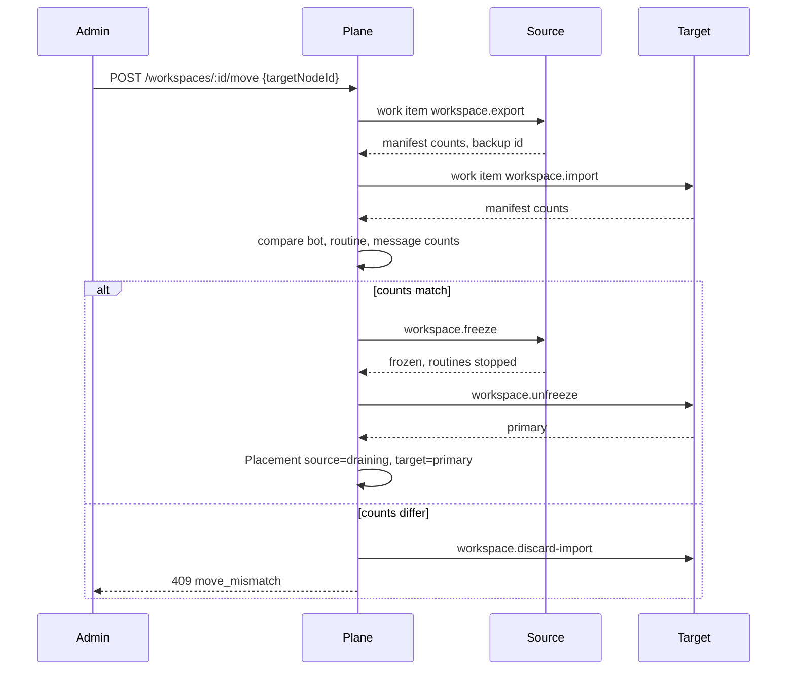

# Spec: scheduling and failover

Where a workspace runs, how it moves, and what a dead node means.

## Invariant

A routine, webhook, or chat turn for a workspace runs on at most one node. Upstream’s one-home comment states the same rule for a laptop and My Cloud: “nothing ever runs in two places.” Agents Hub keeps it across any number of nodes.

## Placement

MVP policy is `pinned`.

```text
Workspace.primaryNodeId  ->  Node
Placement(role=primary, frozen=false)
```

The primary node is the only node that:

- starts scheduled routines
- accepts webhooks for that workspace
- runs chat turns
- holds the writable data dir

Other nodes may appear in the org and do nothing for that workspace.

### Assign

`POST /api/v1/workspaces/:id/placement` body `{ "nodeId": "nd_hub" }`.

Allowed when the workspace has **no** primary yet, or when the only data is empty (no bots). Otherwise the client must call move. The plane rejects a second writer with 409 `placement_exists`.

## Move

A move is a copy, a check, a switch, and a freeze. It is the one-home journal (`electron/one-home.mjs` phases copy → wait → freeze → final → check → switch → done) generalized to any source node and any target node, and it is reversible until the person deletes the source copy.



States on the move row: `exporting`, `importing`, `checking`, `switching`, `done`, `failed`, `reverted`.

Rules:

- Chat turns and routine starts are paused on the source at `switching`, before the target unfreezes. The pause is the fence.
- If the plane crashes after freeze and before unfreeze, recovery freezes **both** and asks the admin to choose. It does not guess.
- Revert (`POST .../move/:moveId/revert`) is allowed while the source copy still exists. It freezes the target and unfreezes the source.
- WhatsApp bridge sessions are not in the backup (see channels spec). A move of a workspace with a sticky channel completes the bot data and then shows “WhatsApp stayed on Hub. Re-pair or keep the channel there.” The channel record’s `nodeId` does not change unless the admin runs a separate channel move, which for WhatsApp means a re-pair.

Quiet period: the source waits until no chat turn has been running for 30 seconds, matching `server/move-waits.ts`’s intent, then exports. Timeout 15 minutes, then `failed` with the source still primary.

## Failover (v1)

Policy `standby` adds a placement `role=standby`. The standby receives a replica on a schedule (every 15 minutes, and after each routine run): an encrypted backup blob written to the standby’s disk. The standby does not start routines while `role=standby`.

When the primary has been `offline` for 90 seconds and the standby is `online` and its replica is under 15 minutes old:

1. Plane writes an audit row `failover.start`.
2. Plane sends `workspace.freeze` to the primary anyway (it may be a network partition and still alive). The primary, if it receives this, stops routines.
3. Plane promotes the standby: `role=primary`, unfreeze, routines that are **not** sticky-channel-dependent start.
4. Routines that need a sticky channel are paused with reason `channel_sticky`.
5. If the old primary comes back, it stays frozen until an admin confirms or reverts. It must not unfreeze itself.

A partition can still double-run if the primary never receives the freeze and also cannot heartbeat. Mitigation in v1: routine claims are fenced with a lease the plane signs (`leaseId`, expiry 60 seconds). The node will not start a routine whose lease it cannot refresh. If the plane is unreachable, a node that is already primary keeps renewing from a locally cached lease for at most 10 minutes, then pauses schedules. Chat the person sends directly to the node (LAN) still works. This bounds split-brain to 10 minutes of schedules, not indefinitely. Document it on the workspace page.

MVP does not implement standby or leases. MVP shows offline and does not start the workspace anywhere else. Tickets say so.

## Scheduling on a healthy primary

The existing routine scheduler in `server/routines.ts` remains the runner. The node agent enables it only when the placement it last received says `primary` and `frozen=false`.

Overlap `skip` and `queue` are unchanged. A run that was `running` when the process died is `failed` on restart with reason `node_restart`, not retried automatically, except schedules that are due again.

## Webhooks

Webhook URLs are served by the primary node. The plane may display a stable URL that reverse-proxies to the current primary (`https://plane.example/hooks/:endpointId` → node). In embedded mode the stable URL is the node’s own URL. Signature verification stays in `server/webhooks.ts`. The sealing key stays on the node and out of backups, as today; a move re-wraps it inside the export that only the two nodes see, and the plane stores a hash to detect a mismatch.

## What the person sees

| Node status | Workspace UI |
| --- | --- |
| online, primary | Running |
| degraded | Running, “heartbeat late” |
| offline, pinned | Offline. Routines will not run elsewhere. |
| move in progress | Moving, with the phase |
| v1 failover done | Running on the standby’s name, with a banner to confirm |

## Non-goals

- Spreading one workspace’s bots across two primaries.
- Load-based autoscaling in MVP.
- Starting a routine on a node that merely has the right label, without a placement.
