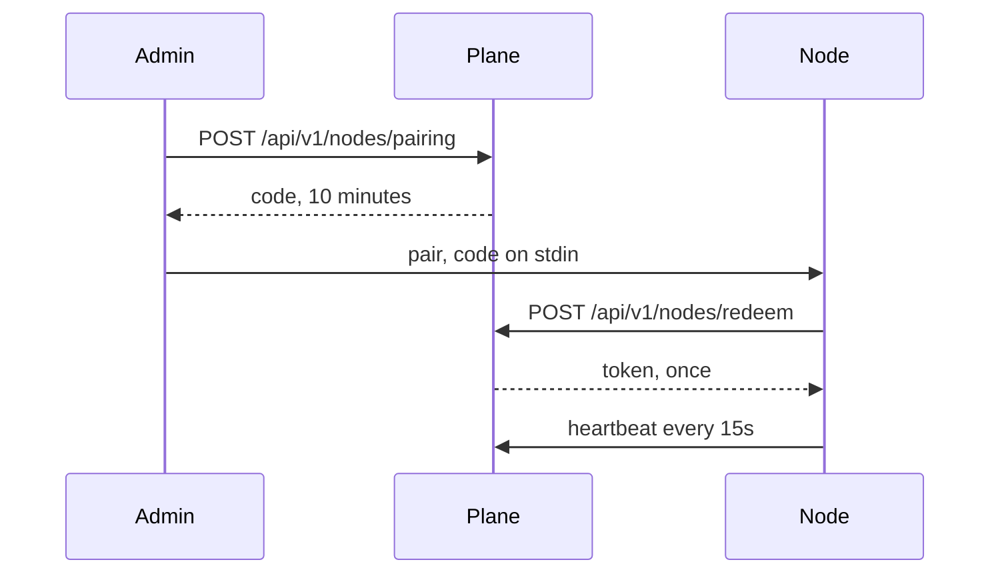

# Flow: add a node

## Diagram

## Steps

| Step | Who | What happens | Result |
| --- | --- | --- | --- |
| 1 | Admin | Chooses local, Docker, or VM and names the node | A one-time code |
| 2 | Person | Runs the installer on that machine and pastes the code on stdin | Token stored mode 0600 |
| 3 | Node | Heartbeats | Status online. No workspace moves. |
| 4 | Admin | Optionally pins a workspace in a separate step | Placement, not an accident of pairing |

Docker, a Mac, and a Linux VM use the same redeem call. A managed node is the same agent, with the token injected at first boot (v1).
