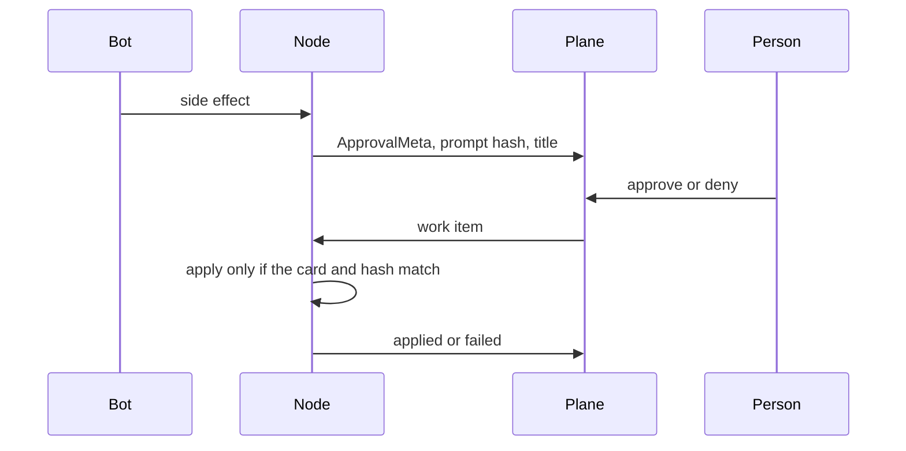

# Flow: approval

## Diagram

## Steps

| Step | Who | What happens | Result |
| --- | --- | --- | --- |
| 1 | Bot | Wants a shell, a send, or a cleanup | Card |
| 2 | Person | Decides in the queue or on the phone | Audit row |
| 3 | Main agent | If the decision is one the ledger records | Learning loop runs after the apply |
| 4 | Node | Applies or refuses a stale card | Second audit row |

Expiry is a deny for the side effect.
