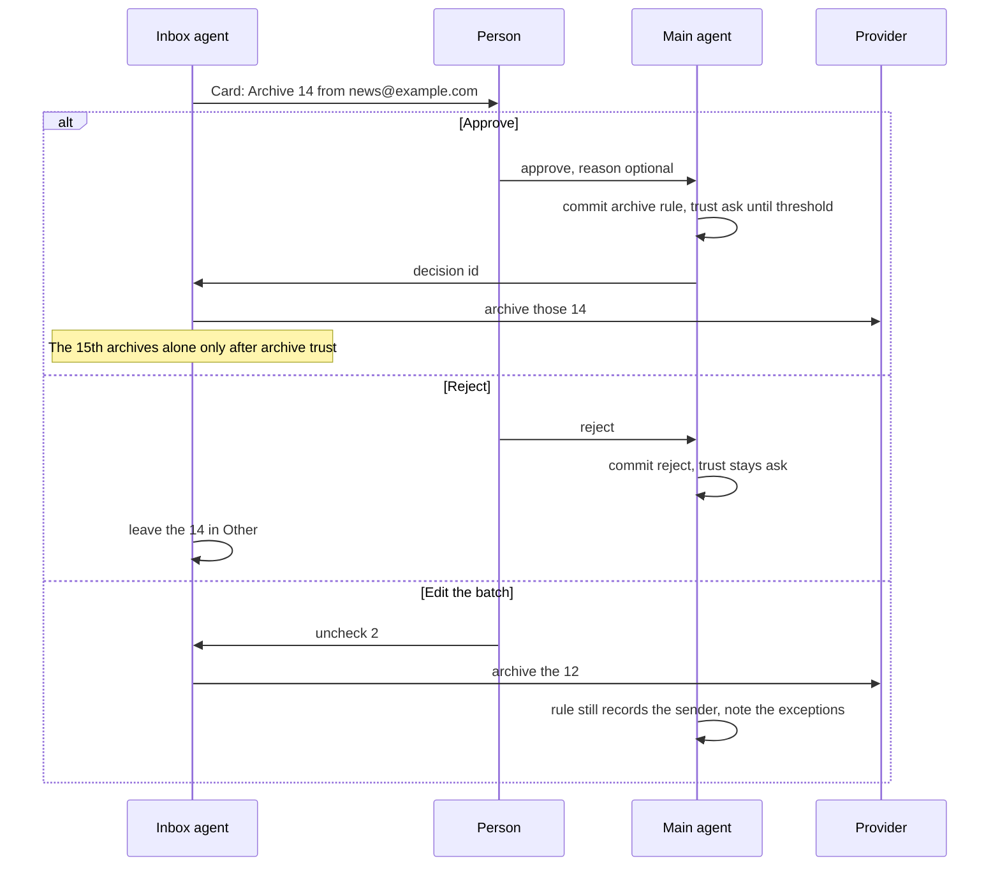

# Flow: approving cleanup

Until a sender or category has earned trust, cleanup is a batch the person approves. Approving writes the rule. The messages in the batch are then acted on. The next one is not asked.

## Diagram

## Steps

| Step | Who | What happens | Result |
| --- | --- | --- | --- |
| 1 | Inbox agent | Groups unresolved Other by sender or category | One card, not fourteen |
| 2 | Person | Opens the card from Inbox, the queue, or the phone | Sees count, sender, proposed action, sample subjects |
| 3 | Person | Approves, rejects, or unchecks rows | A decision, or no decision |
| 4 | Main agent | On approve: `decisions.jsonl` line `archive` or `trash`, `decided_by` the member, `reason` their words or the sentence shown | YAML recompiled |
| 5 | Inbox agent | Applies the action only to the checked ids | Provider updates. Idempotent on retry. |
| 6 | Policy | Counts consistent decisions | Archive trust after 3. Trash trust after 5, and only if archive trust is already held. |
| 7 | Later triage | Matching mail | If trust allows, no card. If still `ask`, a new batch. |

Trash uses the same flow and a stronger sentence: “Trash cannot be undone from Agents Hub.” Archive says it can be undone from the provider.

Send is not this flow. A send card is one draft, and approving it does not teach archive.

## Failure paths

| Case | What the product does |
| --- | --- |
| Provider rejects some ids | Those stay in the batch as failed. The rule is still written if the person approved the sender. The card says which ones remain. |
| Person approves then the main agent cannot commit | The provider is not touched. The card stays pending. |
| Threshold not met | The rule exists with trust `ask`. The next batch is smaller and says “one more archive starts doing this quietly” only when one decision remains. It does not nag before that. |
