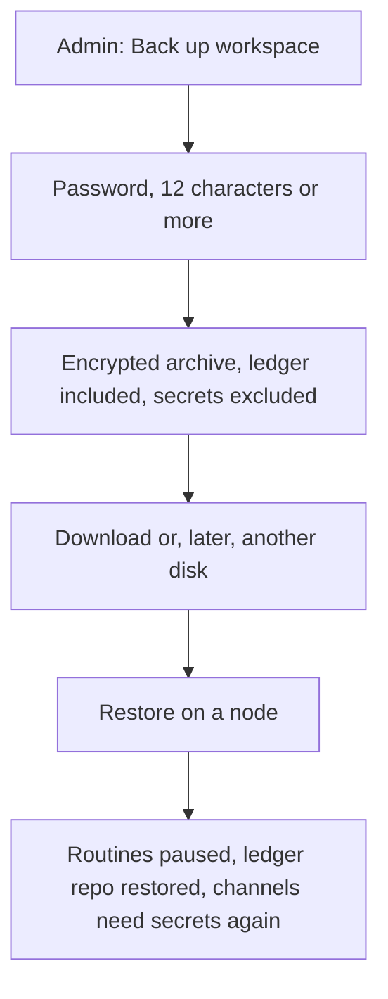

# Flow: backup and restore

## Diagram

## Steps

| Step | Who | What happens | Result |
| --- | --- | --- | --- |
| 1 | Admin | Starts a backup | `.ombbackup` plus an Agents Hub manifest |
| 2 | Archive | Includes the ledger git repo | Does not include connector tokens or the WhatsApp session |
| 3 | Admin | Restores onto a node | Counts checked, routines paused |
| 4 | Person | Reconnects mail and WhatsApp | Inbox cursor can resume. Send trust rules survived. |
