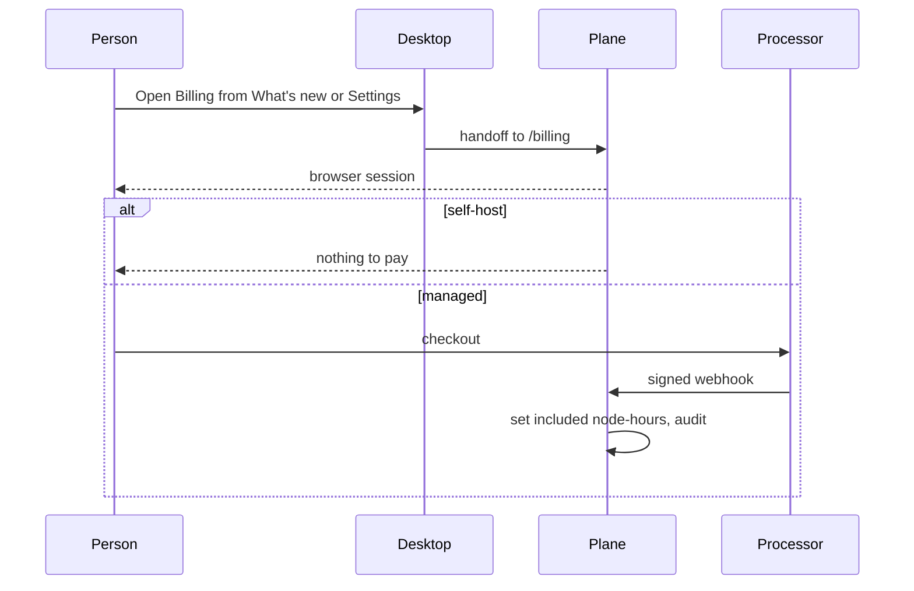

# Flow: billing and upgrade

## Diagram

## Steps

| Step | Who | What happens | Result |
| --- | --- | --- | --- |
| 1 | Person | Chooses a plan on the web | No card form in Electron |
| 2 | Processor | Charges, tax included in its page | Webhook |
| 3 | Plane | Sets the monthly node-hour allowance | Meter becomes “used of included” |
| 4 | Plane | At 100%, if overage is off | New routine starts pause. Chats still run. Data is kept. |
| 5 | Person | Cancels | Access until period end. Attached nodes never stop for billing. |

The screenshot’s “128 of 360” shape is the meter. 360 is a placeholder allowance for a managed plan, not a constant copied from upstream.
