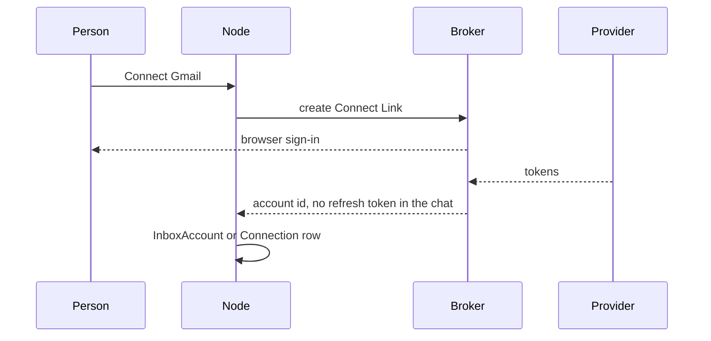

# Flow: connect an app

## Diagram

## Steps

| Step | Who | What happens | Result |
| --- | --- | --- | --- |
| 1 | Person | Picks a provider implementation: Composio, Pipedream, Nango, or MCP | Their own account |
| 2 | Person | Completes OAuth in the browser | Tokens stay at the provider or broker |
| 3 | Node | Stores the connection as private to that member unless they share it | Bots in the workspace can be granted it |
| 4 | Inbox | A mail connection can be marked as an inbox | Triage can run. A generic trigger is not automatically an inbox. |
