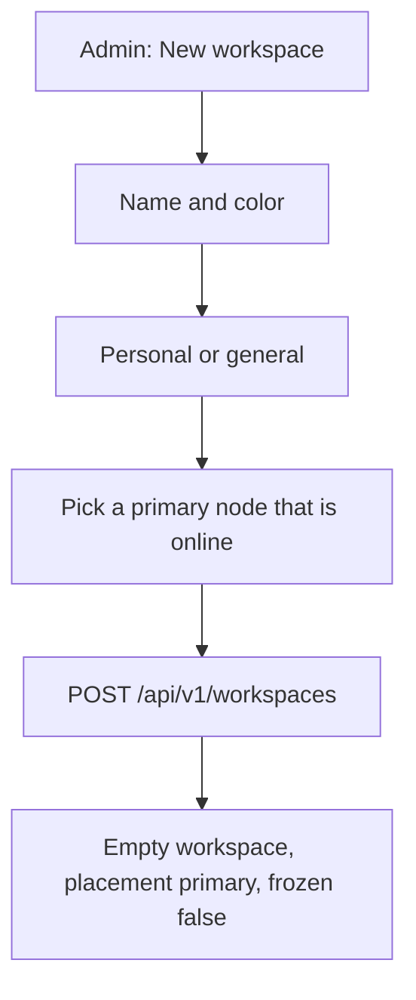

# Flow: create a workspace

## Diagram

## Steps

| Step | Who | What happens | Result |
| --- | --- | --- | --- |
| 1 | Admin | Names it, for example Family or Design Studio | A row |
| 2 | Admin | Marks personal if only the owner should administer it | Owner-proof rules apply |
| 3 | Admin | Chooses the hub or another online node | Pin. Bots created later land there. |
| 4 | Plane | Refuses a second primary | 409 if one already exists. Use Move. |
