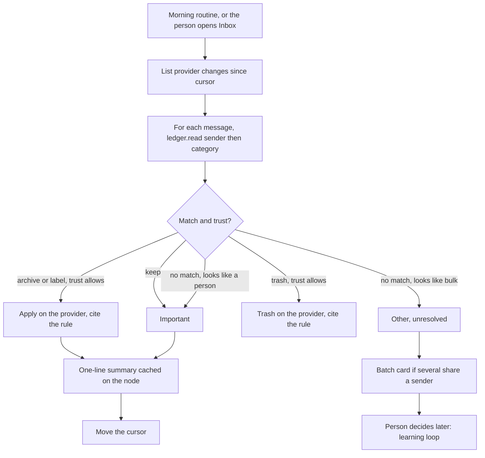

# Flow: inbox triage

A routine on the primary node splits new mail and applies only the rules the ledger already earned.

## Diagram

## Steps

| Step | Who | What happens | Result |
| --- | --- | --- | --- |
| 1 | Routine | Runs at 07:30 workspace time, or when Inbox is opened if the cursor is stale | One run at a time. Overlap is skip. |
| 2 | Inbox agent | `list` since cursor | Page of messages |
| 3 | Inbox agent | `ledger.read` for sender, then category | A rule or a miss |
| 4 | Inbox agent | Important: people and `keep`. Other: known bulk. | Split is visible on the Inbox page |
| 5 | Inbox agent | Applies archive, label, or trash only when trust allows | Provider changes. An agent decision line cites the human decisions. |
| 6 | Inbox agent | Drafts a reply for Important mail that asks for one | Draft in the provider and a card. No send. |
| 7 | Inbox agent | Writes the morning summary into the main chat | Counts and one-liners, not full bodies |
| 8 | Inbox agent | Advances the cursor | A retry sees the same ids and does not double-apply |

## What the person sees

Important is a short list. Other shows “handled by rules” and a smaller “needs a decision” group. Snoozed mail is hidden until its time. A follow-up nudge appears as a card, not as a sent mail.

## Failure paths

| Case | What the product does |
| --- | --- |
| Provider auth expired | Inbox status `error`. Nothing is archived. The morning note says to reconnect. |
| Ledger unreadable | Triage stops. Mail stays in the provider. No guesses. |
| Node offline | No triage. Mail waits in the provider. The plane shows the inbox account offline. |
| Rule would send | Ignored unless `outgoing_trust` is `explicit` and this sender has send trust. Default: a draft only. |
