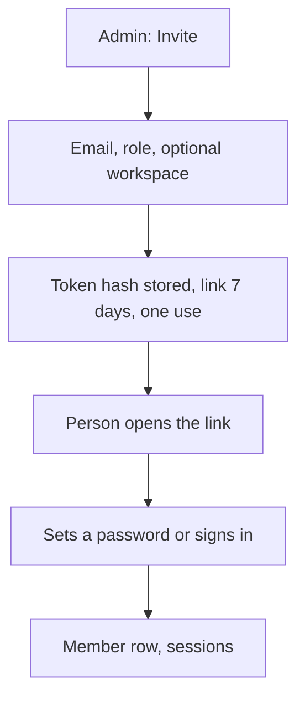

# Flow: invite a team

## Diagram

## Steps

| Step | Who | What happens | Result |
| --- | --- | --- | --- |
| 1 | Admin | Invites by email as member or admin | Link |
| 2 | Person | Accepts | They see only the workspaces on the invite |
| 3 | Admin | Removes them later | Sessions die. `sessionVersion` bumps. |
| 4 | Guest | P1 | Named on a bot, not the whole workspace |

A member does not see another member’s direct transcripts unless the workspace policy is shared.
