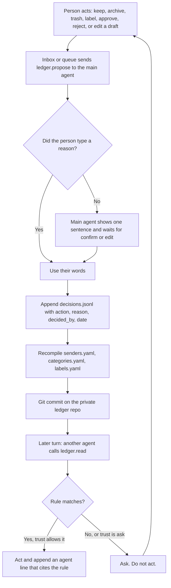

# Flow: learning loop

The person decides once. The main agent writes the ledger. The next agent reads it and does not ask again.

## Diagram

## Steps

| Step | Who | What happens | Result |
| --- | --- | --- | --- |
| 1 | Person | Archives a newsletter, edits a draft, or answers a card | The UI records which object and which action |
| 2 | Inbox or queue | Calls `ledger.propose` on the main agent | Nothing is committed yet |
| 3 | Main agent | If `reason` is empty, shows one sentence | Person can edit it or cancel |
| 4 | Main agent | Appends `decisions.jsonl` | Line has `action`, `reason`, `decided_by`, `date` |
| 5 | Main agent | Recompiles YAML from the log and `policy.yaml` | Sender rule updates or trust resets on a reject |
| 6 | Main agent | Commits the repo | `git log` shows the decision id, no message body |
| 7 | Any agent | `ledger.read` before a later action | Match means act within trust. No match means ask |
| 8 | Person | Opens Ledger | Sees the file, the log, and Revert |

## Failure paths

| Case | What the product does |
| --- | --- |
| Main agent is paused | Proposal stays uncommitted. Inbox does not invent a rule. The mail stays unresolved. |
| Person cancels the reason | No commit. The action they already took in the mailbox stays. No rule is born. |
| Two proposals at once | The main agent serializes commits. The second recompile sees the first. |
| Person undoes the archive | A `reject` decision. Trust for that sender returns to `ask`. |
| Disk full | Commit fails, the card says the ledger was not written, the action is not treated as learned. |
