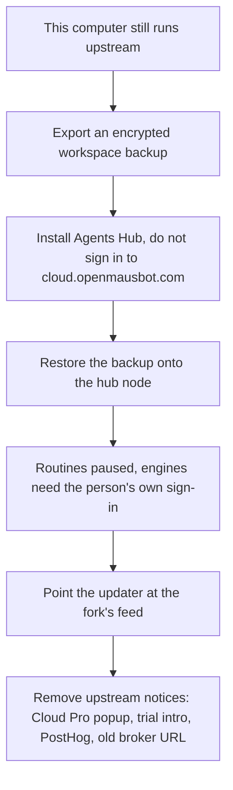

# Flow: migrate from upstream OpenMausBot

## Diagram

## Steps

| Step | Who | What happens | Result |
| --- | --- | --- | --- |
| 1 | Person | Exports from the current app | File they hold |
| 2 | Person | Installs Agents Hub and restores | Bots and chats on the hub |
| 3 | Person | Signs in Claude or Codex on the node | No trial relay |
| 4 | Person | Connects Gmail on their own connector project | Inbox can start empty of rules |
| 5 | Person | Confirms the packaged build does not call upstream hosts | Release checklist |

`enterprise/` data is not imported. The learning ledger starts empty, which is honest: upstream did not have these decisions.
