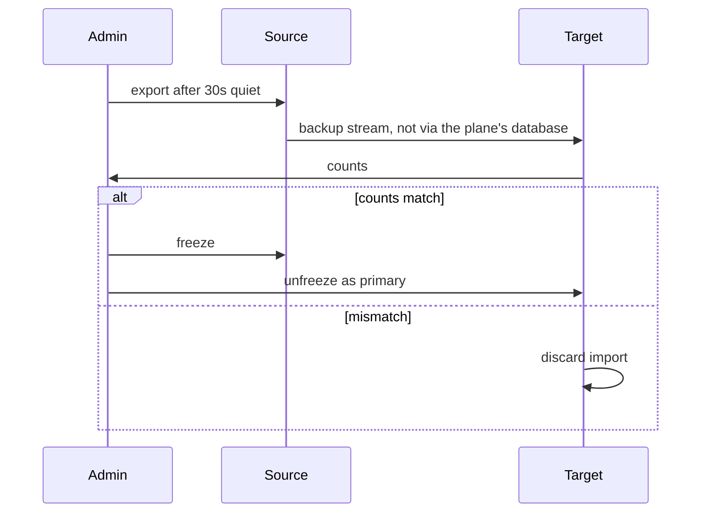

# Flow: move bots between nodes

## Diagram

## Steps

| Step | Who | What happens | Result |
| --- | --- | --- | --- |
| 1 | Admin | Chooses a target node | Move row `exporting` |
| 2 | Source | Waits until no turn is running, up to 15 minutes | Export |
| 3 | Target | Imports and reports bot, routine, and message counts | Check |
| 4 | Plane | On match, freezes source then unfreezes target | One primary |
| 5 | UI | If a WhatsApp bridge or the ledger’s node changed | WhatsApp stays, with a re-pair note. The ledger moves with the data dir. |

Revert freezes the target and unfreezes the source while the source copy exists.
