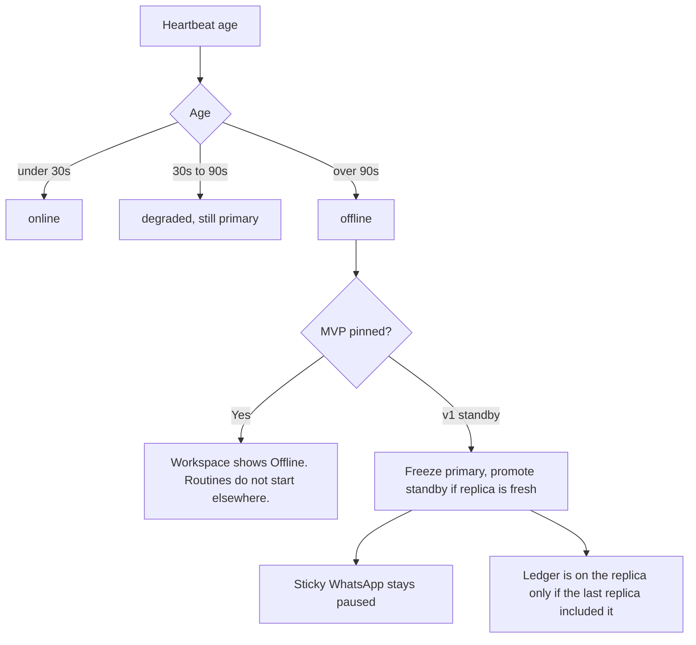

# Flow: a node goes offline

## Diagram

## Steps

| Step | Who | What happens | Result |
| --- | --- | --- | --- |
| 1 | Plane | Marks degraded, then offline | Home shows it |
| 2 | MVP | Does not start the workspace on another node | Mail waits at the provider. Routines miss. |
| 3 | v1 | Promotes a standby only with a fresh replica and a lease | Old primary stays frozen if it returns |
| 4 | Person | Confirms or reverts | No silent double run |

Inbox triage does not run on a node that is not primary.
