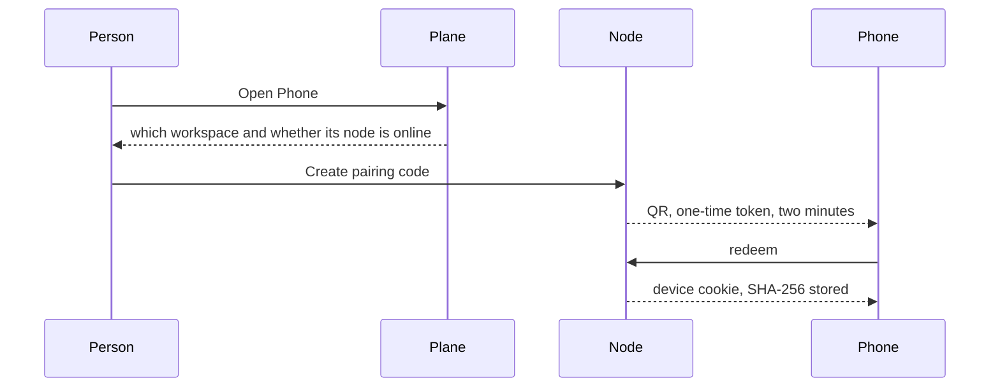

# Flow: phone pairing

## Diagram

## Steps

| Step | Who | What happens | Result |
| --- | --- | --- | --- |
| 1 | Person | Opens Phone in the hub | Sees the node the phone will reach |
| 2 | Person | Creates a code and scans it | Same pairing shape as today |
| 3 | Phone | Loads the web app over Tailscale or the node’s HTTPS | Chats, approvals, inbox cards |
| 4 | Person | Approves a cleanup from the phone | Same decision endpoint. The ledger still commits on the node. |
