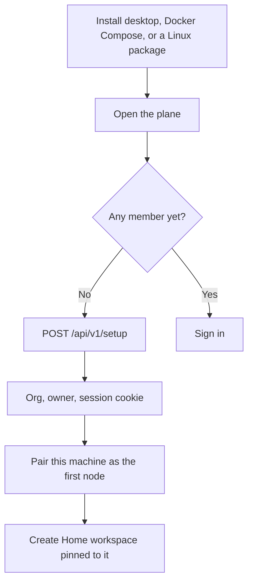

# Flow: sign-up and self-host install

## Diagram

## Steps

| Step | Who | What happens | Result |
| --- | --- | --- | --- |
| 1 | Person | Installs Agents Hub on the hub | Process listens on loopback until they choose otherwise |
| 2 | Person | Names the organization, themselves, and a password | `POST /api/v1/setup` once |
| 3 | Agent | Redeems a pairing code on loopback | Node online |
| 4 | Person | Lands on Home | One workspace, one node, ledger not created until the first decision |

A second install uses sign-in, not setup. Setup returns 409 after the first owner exists.
