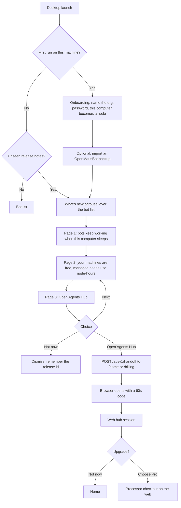

# Flow: What’s new, onboarding, and the upgrade hand-off

The desktop explains Agents Hub. It does not sell a plan and it does not open upstream’s Cloud site. Payment, when there is any, happens on the web hub.

## Diagram

## Steps

| Step | Who | What happens | Result |
| --- | --- | --- | --- |
| 1 | Desktop | First run calls `POST /api/v1/setup` on the embedded plane | Org, owner, this machine paired as the hub node |
| 2 | Desktop | Offers backup import, skippable | Bots appear if a file was chosen |
| 3 | Desktop | Shows a three-page carousel if this release id is unseen | Scrim over the bot list. Dots, Next, Not now. |
| 4 | Page 1 | “Your bots keep working when this computer is off.” | Picture of the hub, not of upstream’s site |
| 5 | Page 2 | Explains node-hours | Attached machines are shown and not billed. A managed node draws a monthly pool. |
| 6 | Page 3 | Primary button **Open Agents Hub**. Secondary **Not now**. | No Get Pro inside the desktop. No price charged here. |
| 7 | Plane | `POST /api/v1/handoff` `{ "to": "/home" }` or `{ "to": "/billing" }` | `{ url, code }`, 60 seconds, one use |
| 8 | Browser | Redeems the code | Session on the web hub |
| 9 | Billing page | Person may pick a plan | Processor hosted page. Desktop never sees the card. |

Copy the carousel may show a placeholder price only as “from the Billing page,” not as a checkout button labeled with upstream’s “Pro · $49/month + tax.”

## Failure paths

| Case | What the product does |
| --- | --- |
| Handoff code expires | The page says to press Open Agents Hub again |
| Plane is self-host and Billing is opened | The page explains there is nothing to pay |
| Person hits Not now | The release id is stored. The carousel does not return until the next release. Settings can replay it. |
